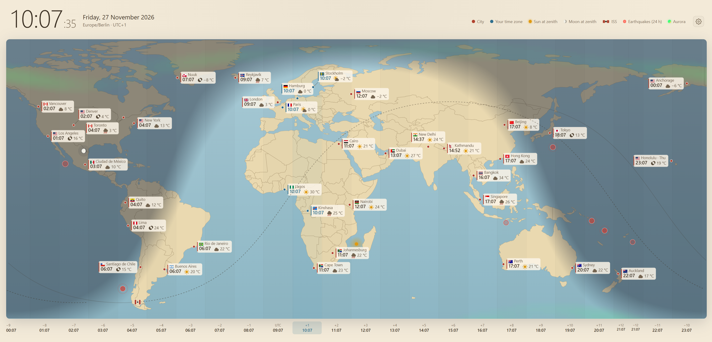

# Weltzeit-Karte

Chrome-Erweiterung (Manifest V3), die die Seite „Neuer Tab“ durch eine Weltkarte ersetzt. Die Karte zeigt die Tag-/Nacht-Grenze, den Sonnen- und Mondstand und die aktuellen Uhrzeiten ausgewählter Städte und aller UTC-Zeitzonen.



## Funktionen

- **Weltkarte im neuen Tab**: Länderumrisse auf einer Karte von 84° N bis 60° S. Die Antarktis ist abgeschnitten.
- **Tag/Nacht-Grenze**: Die Nachtseite wird abgedunkelt, mit weicher Dämmerung bis 12° unter dem Horizont.
- **Sonne im Zenit (optional)**: Markiert den Punkt, an dem die Sonne gerade senkrecht steht (inklusive Zeitgleichung).
- **Mond mit Mondphase (optional)**: Markiert den Punkt, an dem der Mond gerade im Zenit steht. Die Scheibe zeigt die aktuelle Phase, so wie sie von der Nordhalbkugel aus zu sehen ist (zunehmend = rechts hell).
- **Städte mit Uhrzeit**: Jede ausgewählte Stadt bekommt ein Label mit Name und Ortszeit. Liegt die Stadt bereits an einem anderen Tag als du, steht zusätzlich der Wochentag dabei. Labels werden automatisch so platziert, dass sie sich möglichst nicht überlappen, bei Bedarf mit Hilfslinie.
- **Aktuelles Wetter (optional)**: Neben der Uhrzeit jeder Stadt stehen die aktuelle Temperatur in °C und ein kleines Wettersymbol (klar, teils bewölkt, bewölkt, Nebel, Regen, Schnee, Gewitter; nachts mit Mond). Die Symbole übernehmen die Farben des aktiven Themes.
- **Eigene Zeitzone hervorgehoben**: Städte in deiner Zeitzone und der passende Zeitzonen-Streifen sind orange markiert.
- **Zeitzonenleiste**: Unter der Karte steht für jede Zone von UTC−12 bis UTC+12 die aktuelle Uhrzeit.
- **Kopfzeile**: Lokale Uhrzeit mit Sekunden, Datum, Zeitzonenname und UTC-Versatz.
- **Einstellungsseite**:
  - Sechs Farb-Themes (Nacht, Hell, Atlas, Ozean, Abendrot, Terminal) mit Vorschau
  - Eigenes Theme: alle Karten- und Oberflächenfarben sowie die Nachtintensität frei einstellbar
  - Auswahl aus 101 Städten, gruppiert nach Regionen (Nordamerika, Mittel- & Südamerika, Europa, Afrika, Asien, Ozeanien)
  - Sonne, Mond und Wetteranzeige einzeln ein- und ausschalten (Sonne und Mond sind standardmäßig an)
  - Suche nach Stadt oder Zeitzone
  - „Alle auswählen“, „Keine“ und „Standard“, auch einzeln pro Region
  - Eigene Städte mit Name, IANA-Zeitzone (z. B. `Europe/Berlin`) und Koordinaten anlegen
  - Änderungen werden sofort gespeichert und in offenen Tabs übernommen.

## Installation

Die Erweiterung ist nicht im Chrome Web Store veröffentlicht und wird als entpackte Erweiterung geladen:

1. In Chrome `chrome://extensions` öffnen.
2. Oben rechts den **Entwicklermodus** einschalten.
3. Auf **Entpackte Erweiterung laden** klicken und diesen Ordner (`weltkarte`) auswählen.
4. Einen neuen Tab öffnen. Chrome fragt eventuell, ob die geänderte Seite „Neuer Tab“ beibehalten werden soll. Bestätige mit **Änderungen beibehalten**.

Nach Änderungen am Code auf `chrome://extensions` beim Eintrag „Weltzeit-Karte“ auf das Neu-laden-Symbol klicken.

Funktioniert auch in anderen Chromium-Browsern wie Microsoft Edge (`edge://extensions`) oder Brave.

## Bedienung

- **Städte auswählen**: Auf das Zahnrad oben rechts im neuen Tab klicken, oder auf `chrome://extensions` → Weltzeit-Karte → **Details** → **Erweiterungsoptionen**.
- **Eigene Stadt hinzufügen**: Auf der Einstellungsseite unter „Eigene Städte“ Name, Zeitzone, Breiten- und Längengrad eintragen. Für die Zeitzone gibt es Vorschläge zum Auswählen. Koordinaten findest du z. B. per Rechtsklick in Google Maps.
- **Farbschema wählen**: Auf der Einstellungsseite unter „Farbschema“ ein Theme anklicken. Mit „Eigenes Theme“ öffnet sich ein Editor. Er startet mit den Farben des zuletzt gewählten Themes. Über „Farben übernehmen von“ kannst du jederzeit ein fertiges Theme als Ausgangspunkt laden.
- **Sonne und Mond ein- oder ausblenden**: Auf der Einstellungsseite unter „Anzeige“ die Häkchen bei „Sonne anzeigen“ bzw. „Mond anzeigen“ setzen oder entfernen. Die Tag/Nacht-Grenze bleibt immer sichtbar.
- **Wetter anzeigen**: Auf der Einstellungsseite unter „Anzeige“ das Häkchen bei „Aktuelles Wetter anzeigen“ setzen. Die Wetterdaten werden beim Öffnen eines Tabs geladen und alle 15 Minuten aktualisiert. Ohne Internetverbindung erscheinen die Labels einfach ohne Wetter.
- **Zurücksetzen**: „Standard“ stellt die 31 vorausgewählten Städte wieder her. Eigene Städte bleiben erhalten, werden aber abgewählt.

## Berechtigungen und Datenschutz

| Berechtigung | Zweck |
| --- | --- |
| `storage` | Speichert die Städteauswahl, eigene Städte und Einstellungen in `chrome.storage.sync`. Mit aktivierter Chrome-Synchronisierung sind sie auf allen deinen Geräten verfügbar. Wetterdaten werden in `chrome.storage.local` zwischengespeichert. |

Kartendaten, Städtekatalog und Berechnungen sind vollständig lokal. Solange die Wetteranzeige ausgeschaltet ist (Standard), lädt die Erweiterung nichts aus dem Internet und sendet keine Daten.

Mit eingeschalteter Wetteranzeige werden die Koordinaten der ausgewählten Städte (auf zwei Nachkommastellen gerundet) an die freie Wetter-API von [Open-Meteo](https://open-meteo.com/) gesendet. Es werden weder dein eigener Standort noch andere persönliche Daten übertragen, und es ist kein API-Schlüssel nötig. Die Ergebnisse werden 15 Minuten lang zwischengespeichert, damit nicht jeder neue Tab eine Anfrage auslöst. Die kostenlose Nutzung von Open-Meteo ist auf nicht-kommerzielle Zwecke beschränkt.

## Projektstruktur

```
weltkarte/
├── LICENSE                    MIT-Lizenz
├── manifest.json              Manifest V3: ersetzt den neuen Tab, Einstellungsseite, Icons
├── newtab.html                Seite „Neuer Tab“
├── app.js                     Karte zeichnen (Canvas), Sonnen- und Mondstand, Nachtschatten, Labels, Zeitzonenleiste
├── style.css                  Styles für den neuen Tab
├── options.html               Einstellungsseite
├── options.js                 Städteauswahl, Suche, eigene Städte
├── options.css                Styles für die Einstellungsseite
├── cities.js                  Gemeinsam genutzt: Städtekatalog, Standardauswahl, Speicherzugriff
├── weather.js                 Wetterdaten von Open-Meteo laden und cachen, Wettersymbole zeichnen
├── data/countries-110m.json   Länderumrisse als TopoJSON (Maßstab 1:110 Mio.)
├── docs/                      Screenshots für die README
└── icons/                     Icons in 16, 48 und 128 px
```

## Technische Details

- **Keine Abhängigkeiten, kein Build-Schritt**: Reines HTML, CSS und JavaScript.
- **Rendering**: Die Karte wird auf ein `<canvas>` in einfacher Plattkarten-Projektion gezeichnet und an die Pixeldichte des Bildschirms angepasst. Land, Grenzen und Zeitzonen-Streifen liegen in einer gecachten Basisebene. Nur Nachtschatten, Sonne, Mond und Städte werden neu gezeichnet.
- **Aktualisierung**: Die Uhr in der Kopfzeile läuft sekündlich, die Karte wird einmal pro Minute neu gezeichnet und zusätzlich, sobald der Tab wieder sichtbar wird.
- **TopoJSON**: Wird ohne Bibliothek direkt in `app.js` dekodiert. Polygone, die die Datumsgrenze überqueren (z. B. Russland, Fidschi), werden „abgewickelt“ und versetzt doppelt gezeichnet.
- **Wetter**: Alle Städte werden in einer einzigen Sammelanfrage an Open-Meteo abgefragt (`current=temperature_2m,weather_code,is_day`). Die WMO-Wettercodes werden auf sieben Symboltypen abgebildet, die direkt auf das Canvas gezeichnet werden. Open-Meteo erlaubt Anfragen von jeder Herkunft (CORS), deshalb braucht die Erweiterung keine zusätzliche Host-Berechtigung.
- **Mond**: Position und Phase werden mit den Hauptstörungstermen der Mondbahn (nach Meeus) berechnet, genau auf etwa ein Grad. Die Phase ergibt sich aus der Elongation zwischen Mond und Sonne.
- **Zeitzonen**: Alle Uhrzeiten kommen über `Intl.DateTimeFormat` aus der Zeitzonendatenbank des Browsers. Sommerzeit wird dadurch automatisch berücksichtigt.
- **Lokales Testen**: `newtab.html` und `options.html` lassen sich auch über einen einfachen lokalen Webserver ohne Erweiterungskontext öffnen. Die Einstellungen landen dann im `localStorage`. Ein direkter Aufruf über `file://` funktioniert nicht, weil der Browser dann `fetch()` für die Kartendaten blockiert.

  ```sh
  python -m http.server 8000
  # dann http://localhost:8000/newtab.html öffnen
  ```

### Städtekatalog erweitern

Neue Städte für alle Nutzer werden in `cities.js` im Array `CATALOG_RAW` ergänzt:

```js
// [Name, IANA-Zeitzone, Breite, Länge, Region-Index]
['Bremen', 'Europe/Berlin', 53.08, 8.80, 2],
```

Der Region-Index verweist auf das Array `REGIONS`. Die ID wird automatisch aus dem Namen erzeugt (z. B. `mexiko-stadt`). Soll die Stadt standardmäßig ausgewählt sein, die ID zusätzlich in `DEFAULT_IDS` eintragen.

## Version

1.4.0

## Lizenz

Veröffentlicht unter der [MIT-Lizenz](LICENSE).
