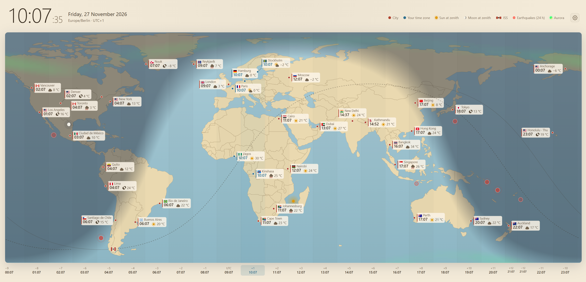

# Weltzeit-Karte (World Clock Map)

*Deutsche Version: [README.md](README.md)*

Browser extension (Manifest V3) for Chrome and Firefox that replaces the "New Tab" page with a world map. The map shows the day/night boundary, the positions of the sun and moon, and the current times of selected cities and all UTC time zones.



## Features

- **World map in the new tab**: Country outlines on a map from 84° N to 60° S. Antarctica is cut off.
- **Day/night boundary**: The night side is darkened, with a soft twilight down to 12° below the horizon.
- **Noon in the centre (optional)**: Instead of letting the day/night boundary move across the map, the map itself moves. The place where it is currently 12 noon (sun at its highest) then always stays in the centre. Cities, sun, moon, ISS, earthquakes, aurora and the time zone bar move along, and the map wraps seamlessly at the edges.
- **Sun at zenith (optional)**: Marks the point where the sun is currently directly overhead (including the equation of time). Hovering shows a tooltip.
- **Moon with moon phase (optional)**: Marks the point where the moon is currently at its zenith. The disc shows the current phase as seen from the northern hemisphere (waxing = lit on the right). Hovering shows a tooltip with the name of the phase (e.g. "Waxing gibbous") and the illuminated fraction in percent.
- **ISS (optional)**: Shows the current position of the International Space Station as a small icon, along with its ground track: half an orbit back (faint) and one orbit ahead (dashed). The position is updated every 10 seconds. Hovering shows a tooltip with coordinates and orbital altitude.
- **Earthquakes (optional)**: Marks the earthquakes of the last 24 hours as red circles whose size grows with magnitude. The circles slowly "breathe", and every 4 seconds or so a faint wave runs outwards from each of them, two for quakes from the last hour. Older quakes fade. With the system setting "Reduce motion", the markers stay static. The minimum magnitude is adjustable (from 2.5 up to 6.0, default 4.5). Hovering shows a tooltip with magnitude, region, time, coordinates and focal depth. Data from the USGS, updated every 10 minutes.
- **Aurora (optional)**: Shows the short-term forecast (30–90 minutes) of the NOAA Space Weather Prediction Center (OVATION model) of where aurora might be visible, as a softly drawn area: green for low, through yellow to red for high probability. Hovering shows a tooltip with the probability at that spot and the forecast time; a city's tooltip also mentions it if it is above 0%. Updated every 10 minutes.
- **Cities with local time**: Each selected city gets a label with its name and local time. If the city is already on a different day than you, the weekday is shown as well. Labels are placed automatically so that they overlap as little as possible, with a leader line if needed.
- **City info in the tooltip**: Hovering over a city (dot or label) shows a tooltip with latitude and longitude as well as sunrise, sunset and day length for today, each in local time. North or south of the polar circles it may say "Polar day" or "Polar night" instead.
- **Country flags (optional)**: The flag of the corresponding country is shown to the left of the place name. For custom cities, the country can be chosen when adding them.
- **Current weather (optional)**: Next to each city's time, the current temperature (in °C or °F) and a small weather icon are shown (clear, partly cloudy, cloudy, fog, rain, snow, thunderstorm; with a moon at night). The icons adopt the colours of the active theme.
- **Your own time zone highlighted**: Cities in your time zone and the matching time zone band are marked in orange.
- **Time zone bar**: Below the map, the current time is shown for every zone from UTC−12 to UTC+12.
- **Header**: Local time with seconds, date, time zone name and UTC offset.
- **Settings page**:
  - Twelve colour themes (Night, Light, Atlas, Ocean, Sunset, Terminal, Autumn, High contrast, Rosé, Neon, Golden, Meadow) with preview
  - Custom theme: all map and interface colours as well as the night intensity can be set freely
  - Choice of 101 cities, grouped by region (North America, Central & South America, Europe, Africa, Asia, Oceania)
  - Sun, moon, ISS, earthquakes (with minimum magnitude), aurora, "Noon in the centre", country flags and weather display can each be switched on and off (sun and moon are on by default)
  - Time format: 24 hours (default) or 12 hours with AM/PM; applies to the header, cities, time zone bar and sun times
  - Temperature unit: °C (default) or °F
  - Language: German (default), English, French, Italian or Swedish; applies to all texts on the map and the settings page, and open tabs switch immediately. Place names are always shown in the local language (e.g. "Lisboa", "København", "Ciudad de México"), or in English for non-Latin scripts (e.g. "Tokyo", "Moscow", "Cairo"). Country names, dates and weekdays follow the selected language.
  - Search by city, country or time zone
  - "Select all", "None" and "Default", also per region
  - Add custom cities with name, IANA time zone (e.g. `Europe/Berlin`), country (optional, for the flag) and coordinates
  - Changes are saved immediately and applied to open tabs.

## Installation

The extension is not published in the Chrome Web Store and is loaded as an unpacked extension:

1. Open `chrome://extensions` in Chrome.
2. Turn on **Developer mode** in the top right.
3. Click **Load unpacked** and select this folder (`weltkarte`).
4. Open a new tab. Chrome may ask whether you want to keep the changed "New Tab" page. Confirm with **Keep changes**.

After changing the code, click the reload icon on the "Weltzeit-Karte" entry at `chrome://extensions`.

Also works in other Chromium browsers such as Microsoft Edge (`edge://extensions`) or Brave.

When loading, Chrome may show the warning "Unrecognized manifest key 'browser_specific_settings'". This entry is only meant for Firefox; the warning can be ignored.

### Firefox

Requires Firefox 128 or newer. Without signing by Mozilla, the extension can only be loaded temporarily in regular Firefox versions:

1. Open `about:debugging#/runtime/this-firefox` in Firefox.
2. Click **Load Temporary Add-on…** and select the file `manifest.json` in this folder.
3. Open a new tab. Firefox may ask whether you want to keep the changed "New Tab" page. Confirm with **Keep changes**.

The temporary add-on only stays installed until Firefox is closed. After changing the code, click **Reload** on the "Weltzeit-Karte" entry at `about:debugging`.

There are two ways to install it permanently:

- **Get it signed**: Pack the folder contents as a ZIP (the files directly in the ZIP, not in a subfolder) and upload it to [addons.mozilla.org](https://addons.mozilla.org/developers/), either publicly or as "self-distributed" (unlisted). The signed `.xpi` file can then be installed normally.
- **Without a signature**: In Firefox Developer Edition, Nightly or ESR, set `xpinstall.signatures.required` to `false` in `about:config`, and load the ZIP file (renamed to `.xpi`) via `about:addons` → gear icon → **Install Add-on From File…**.

The add-on ID `weltzeit-karte@plattsnacker` is fixed in the manifest. Without a fixed ID, Firefox would assign a new one on every load, and the saved settings would be lost.

## Usage

- **Select cities**: Click the gear icon in the top right of the new tab, or go to `chrome://extensions` → Weltzeit-Karte → **Details** → **Extension options**.
- **Add a custom city**: On the settings page, under "Custom cities", enter the name, time zone, latitude and longitude. Suggestions are offered for the time zone. You can find coordinates e.g. by right-clicking in Google Maps.
- **Choose a colour scheme**: On the settings page, under "Colour scheme", click a theme. "Custom theme" opens an editor. It starts with the colours of the most recently selected theme. With "Copy colours from" you can load a ready-made theme as a starting point at any time.
- **Show or hide the sun and moon**: On the settings page, under "Display", tick or untick "Show sun" or "Show moon". The day/night boundary always stays visible.
- **Show the ISS**: On the settings page, under "Display", tick "Show ISS". The orbital data is loaded when a tab is opened and renewed every 6 hours. Without an internet connection, cached orbital data is used for up to a week; after that the ISS is hidden.
- **Show country flags**: On the settings page, under "Display", tick "Show country flags". The flags are included locally in the extension; nothing is downloaded.
- **Show the weather**: On the settings page, under "Display", tick "Show current weather". The weather data is loaded when a tab is opened and updated every 15 minutes. Without an internet connection, the labels simply appear without weather.
- **Reset**: "Default" restores the 31 preselected cities. Custom cities are kept but deselected.

## Permissions and privacy

| Permission | Purpose |
| --- | --- |
| `storage` | Stores the city selection, custom cities and settings in `chrome.storage.sync`. With Chrome or Firefox sync enabled, they are available on all your devices. Weather data, ISS orbital data, earthquake data and the aurora forecast are cached in `chrome.storage.local`. |

Map data, the city catalogue and all calculations are entirely local. As long as weather, ISS, earthquakes and aurora are switched off (the default), the extension does not download anything from the internet and does not send any data.

With the weather display switched on, the coordinates of the selected cities (rounded to two decimal places) are sent to the free weather API of [Open-Meteo](https://open-meteo.com/). Neither your own location nor any other personal data is transmitted, and no API key is required. The results are cached for 15 minutes so that not every new tab triggers a request. Free use of Open-Meteo is limited to non-commercial purposes.

With the ISS display switched on, the extension downloads the current orbital elements (TLE) of the ISS from [CelesTrak](https://celestrak.org/) at most every 6 hours. The request is the same for all users and contains no data about you or your cities. The position of the ISS is calculated locally from it.

With the earthquake display switched on, the extension downloads the list of earthquakes of the last 24 hours from the [USGS](https://earthquake.usgs.gov/earthquakes/feed/) at most every 10 minutes. Depending on the selected minimum magnitude, one of the public feeds is requested. The request is the same for all users and contains no data about you or your cities.

With the aurora display switched on, the extension downloads the current forecast from the [NOAA Space Weather Prediction Center](https://www.swpc.noaa.gov/products/aurora-30-minute-forecast) at most every 10 minutes. This request, too, is the same for all users and contains no data about you or your cities.

## Project structure

```
weltkarte/
├── LICENSE                    MIT licence
├── manifest.json              Manifest V3: replaces the new tab, settings page, icons
├── newtab.html                "New Tab" page
├── app.js                     Map drawing (canvas), sun and moon position, ISS, night shade, labels, time zone bar
├── style.css                  Styles for the new tab
├── options.html               Settings page
├── options.js                 City selection, search, custom cities
├── options.css                Styles for the settings page
├── i18n.js                    Translations (de, en, fr, it, sv) and helper functions for switching languages
├── cities.js                  Shared: city catalogue, default selection, storage access, flag helpers
├── weather.js                 Load and cache weather data from Open-Meteo, draw weather icons
├── iss.js                     Load and cache ISS orbital elements from CelesTrak, compute position and ground track
├── data/countries-110m.json   Country outlines as TopoJSON (scale 1:110 million)
├── flags/                     Country flags as SVG (4:3) from flag-icons, with their own MIT licence
├── docs/                      Screenshots for the README
└── icons/                     Icons in 16, 48 and 128 px
```

## Technical details

- **No dependencies, no build step**: Plain HTML, CSS and JavaScript.
- **Chrome and Firefox from one code base**: The code uses the `chrome.*` namespace. Firefox provides it in Manifest V3 as well, including promises. The only Firefox-specific part is the `browser_specific_settings` block in the manifest (add-on ID, minimum version, data collection declaration). Chrome ignores it.
- **Rendering**: The map is drawn on a `<canvas>` in a simple equirectangular projection and adapted to the screen's pixel density. Land, borders and time zone bands live in a cached base layer. Only the night shade, sun, moon, ISS and cities are redrawn.
- **Updates**: The clock in the header ticks every second; the map is redrawn once a minute (every 10 seconds with the ISS switched on) and additionally whenever the tab becomes visible again.
- **TopoJSON**: Decoded directly in `app.js` without a library. Polygons that cross the date line (e.g. Russia, Fiji) are "unwrapped" and drawn twice with an offset.
- **Weather**: All cities are queried in a single batch request to Open-Meteo (`current=temperature_2m,weather_code,is_day`). The WMO weather codes are mapped to seven icon types, which are drawn directly onto the canvas. Open-Meteo allows requests from any origin (CORS), so the extension does not need an additional host permission.
- **Moon**: Position and phase are calculated using the main perturbation terms of the lunar orbit (after Meeus), accurate to about one degree. The phase results from the elongation between moon and sun.
- **ISS**: The position is calculated locally from the orbital elements (two-line elements): a Kepler orbit with the secular perturbations caused by the Earth's oblateness (J2) and the orbital decay caused by the residual atmosphere, converted to geographic coordinates via sidereal time and the WGS84 ellipsoid. With fresh orbital elements, the deviation from a full SGP4 calculation is a few to a few tens of kilometres, i.e. less than one pixel to a few pixels on the map. CelesTrak allows requests from any origin (CORS); no host permission is needed.
- **Languages**: All texts live in `i18n.js` (object `STRINGS`, one block per language with the same keys). Static texts in the HTML pages carry `data-i18n` attributes; dynamic texts are fetched in code via `tr(key, params)`. If a key is missing, German is used. Dates, weekdays, decimal separators and country names come from `Intl` according to the language.
- **Time zones**: All times come from the browser's time zone database via `Intl.DateTimeFormat`. Daylight saving time is therefore taken into account automatically.
- **Local testing**: `newtab.html` and `options.html` can also be opened via a simple local web server without an extension context. The settings are then stored in `localStorage`. Opening them directly via `file://` does not work, because the browser then blocks `fetch()` for the map data.

  ```sh
  python -m http.server 8000
  # then open http://localhost:8000/newtab.html
  ```

### Extending the city catalogue

New cities for all users are added in `cities.js` in the array `CATALOG_RAW`:

```js
// [name, IANA time zone, latitude, longitude, region index, country code]
['Bremen', 'Europe/Berlin', 53.08, 8.80, 2, 'de'],
```

Enter the name in the local language, or in English for non-Latin scripts; place names are not translated. The region index refers to the array `REGIONS`, the country code (ISO 3166-1 alpha-2, lower case) to the flag in `flags/`. The ID is generated automatically from the name (e.g. `bremen`); an optional seventh field sets it explicitly. This is necessary for renamed cities so that saved selections are preserved (e.g. `Lisboa` with the ID `lissabon`). If the city should be selected by default, also add its ID to `DEFAULT_IDS`.

## Version

1.11.0

## Licence

Released under the [MIT licence](LICENSE).

The flags in `flags/` come from [flag-icons](https://github.com/lipis/flag-icons) (MIT licence, see `flags/LICENSE`).
